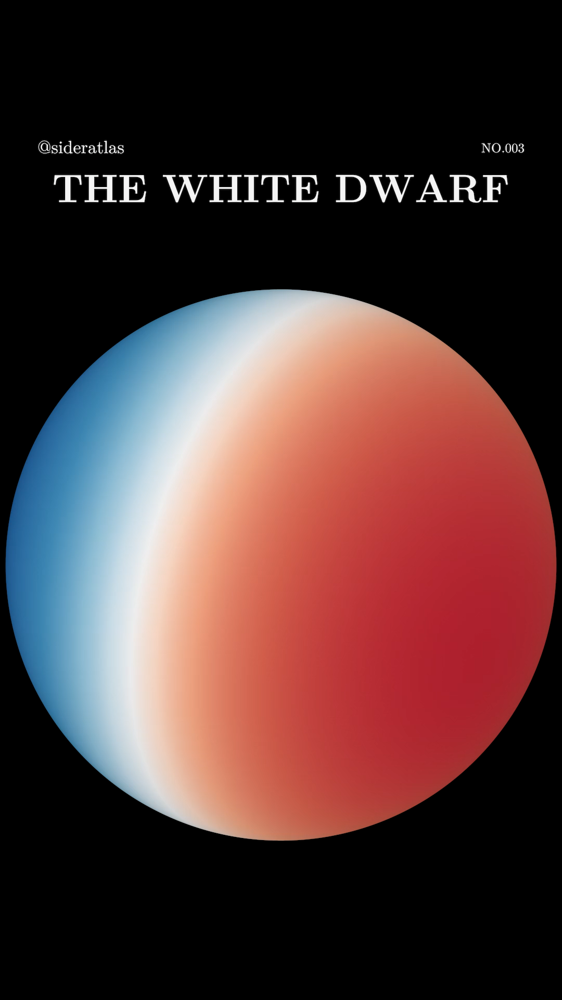
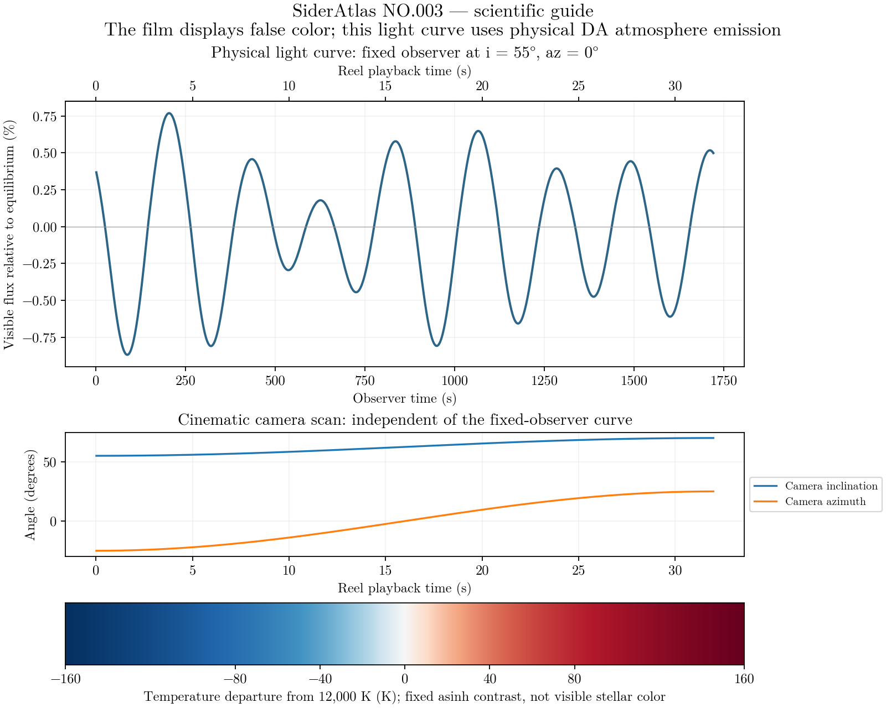

# SiderAtlas NO.003 — THE WHITE DWARF

**A minimalist, 32-second visualization of nonradial temperature pulsations in a representative DA / ZZ Ceti white dwarf.**

[Download the 1080 × 1920 Reel](https://github.com/Loganpis/sideratlas-white-dwarf/releases/latest/download/sideratlas-no003-the-white-dwarf-32s.mp4) · [Scientific caption](instagram-description.text) · [Complete release bundle](https://github.com/Loganpis/sideratlas-white-dwarf/releases/latest/download/sideratlas-white-dwarf-v1.0.0.zip)



## What the film shows

Three existing low-degree surface-flux modes interfere as a slow cinematic camera scan reveals the projected star. The film contains only **THE WHITE DWARF**, **@sideratlas** and **NO.003**, on black. No contour, chart, scale, decorative texture, deformation or invented surface activity is included.

Blue and red are **false colors of temperature departure from 12,000 K**, not the star's visible spectrum. A fixed ±160 K scale with an asinh stretch (18 K softening) reveals small departures without increasing their physical amplitudes. The calculated, time-dependent DA atmosphere radiance supplies the surface shading. False-color image brightness is not itself physical photometry.

The star has M = 0.6 M☉ and a cold mass–radius estimate R ≈ 8,658 km. The three observer-frame periods are 215.20, 270.46 and 304.05 s. The film covers **1,721.6 physical seconds at 53.8× speed**: continuous evolution with eight dominant-mode cycles and one camera scan, rather than repeated 8-second clips. It is not forced into a seamless loop.

**Scientific scope:** the mode geometry, amplitudes and phases are prescribed photospheric flux modes with representative observed periods. This is not a solved stellar-interior eigenmode spectrum or a reconstruction of a named star. Published hydrogen-atmosphere spectra and DA-3D broadband limb fits supply the emission model. [Full equations and limitations](docs/MODEL.md) · [Primary references and input provenance](docs/SOURCES.md)

## Independent fixed-observer light curve

The companion curve uses **i = 55°, az = 0° throughout**. It is calculated from physical atmosphere radiation and photon arrival times, independently of the film's camera. It is not obtained by summing false-color pixels or the changing visible hemisphere in the movie.



Numerical results: [convergence checks](validation/numerical-convergence.json), [movie and photometry validation](validation/final-validation.json), [physical light curve](output/fixed-observer-light-curve.csv), [camera schedule](output/camera-schedule.csv), [render parameters and provenance](output/render-metadata.json).

## Reproduce

Tested with Python 3.12.2, including a fresh isolated installation. Use Python 3.12 with the complete tested dependency lock below; `requirements.txt` also lists the direct package pins. Install FFmpeg with **libx264 and zscale** separately. The selected numerical inputs and font files are included, so the normal render needs no network access after setup. Production library/FreeType versions are recorded in `validation/runtime-environment.json`; minor rasterization/encoder differences between platforms need not be bit-identical.

```sh
python -m venv .venv
source .venv/bin/activate
python -m pip install -r requirements-lock.txt
python -m pytest -q
python validate_calculations.py
python render_reel.py
python validate_reel.py
```

`render_reel.py` saves four-second checkpoints in `output/.chunks/` and automatically resumes completed chunks. The chunks use closed GOPs and are concatenated **without re-encoding, repeating or dropping simulation frames**. An input fingerprint prevents mixing checkpoints from different configurations or physics. Use a fresh output/checkpoint directory after changing source or parameters.

For a quick full-resolution image check:

```sh
python render_reel.py --stills-only --frames 0 480 --output validation/stills
```

The public movie is H.264 High, 1080 × 1920, 30 fps, exactly 960 frames / 32 seconds, Rec.709 limited range, fast-start MP4, no audio. Gradients remain 16-bit until the final color conversion; quantization error diffusion reduces 8-bit banding. This is encoding, not added surface texture. Instagram performs its own delivery compression.

## Package layout

| File | Role |
| --- | --- |
| `src/white_dwarf.py` | Original stellar, mode, atmosphere and direct-ray calculations, preserved unchanged |
| `src/visualization.py` | Projection, camera, fixed contrast, atmospheric shading, exact limb coverage and fixed-observer photometry |
| `config.json` | Final dimensions, time span, camera path, scale, sampling and three approved labels |
| `requirements-lock.txt` | Complete dependency versions verified in a fresh Python 3.12 environment |
| `render_reel.py` / `final_export.py` | Resumable renderer and high-depth-input H.264 export |
| `validate_calculations.py` / `validate_reel.py` | Numerical convergence, independent photometry and color-managed video verification |
| `data/` | Original spectra, limb tables, CIE functions, checksums and small radiation cache |
| `tests/` | Physics, coordinate, interpolation, coverage and minimal-composition tests |
| `output/` | Small measured results in Git; the video is distributed as a release asset |
| `instagram-description.text` | Scientific caption, including false-color and contrast disclosures |

Rebuild the small radiation cache with `python src/white_dwarf.py` if necessary. `download_spectra.py` can re-fetch the selected public atmosphere files; exact URLs and hashes are in `data/spectra-provenance.json`.

Original code/documentation: MIT. Scientific inputs and fonts retain their own attribution and terms; see [data provenance](data/PROVENANCE.md), [sources](docs/SOURCES.md) and `fonts/`. No NASA animation footage, artificial stellar texture or expensive new hydrodynamic simulation is used.
